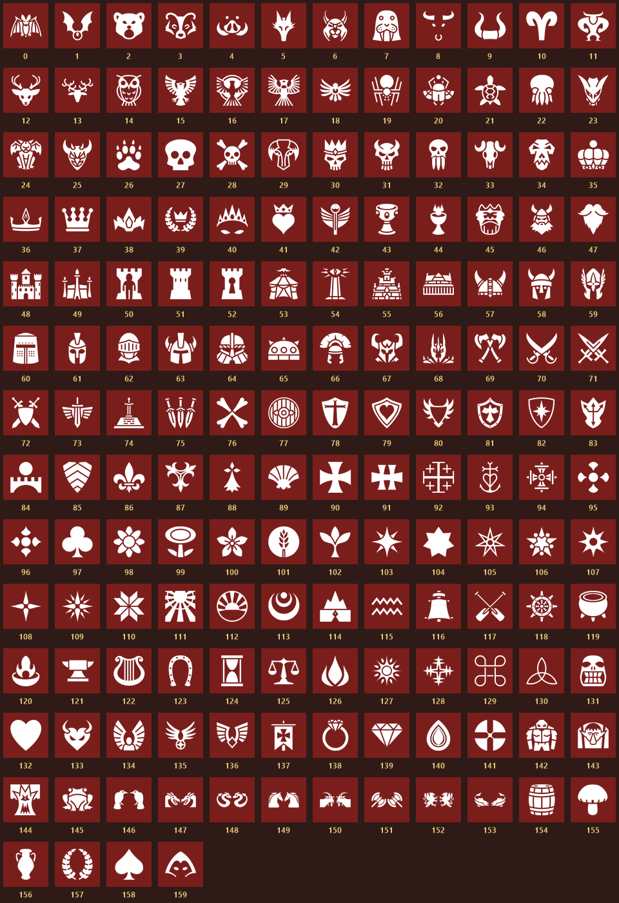

# Heraldry

Paint a heraldic symbol on any vanilla banner. You choose it by typing a number, just like writing on a sign.

## Features

- 160 symbols to choose from: beasts, skulls, crowns, castles, weapons, ships, stars and more.
- Works on the vanilla banners themselves, including the ones you have already built.
- Each symbol is embroidered over the banner's own design, in a colour that suits that banner.
- Optional large banners: a "Large" version of every banner, twice the size for twice the
  materials. Off by default.

## How to use

- Interact with a banner and type a symbol number from 0 to 159, e.g. `42`. The banner previews
  the symbol while you type; Enter saves it and Escape keeps the old one.
- Leave the number empty for a plain vanilla banner.
- Anyone with ward access can change a banner's symbol, as with a sign.

## Installation

- Requires [Jotunn](https://thunderstore.io/c/valheim/p/ValheimModding/Jotunn/). Every player
  and the server need the mod, at the same minor version.
- The banner texts follow the game's language, in every language Valheim offers except Abenaki.
- Mods that change the vanilla banners themselves, such as BannerColorizer, may conflict.
- Uninstalling is safe: banners simply look vanilla again and keep their symbol number, so the
  symbols come back if you reinstall. Large banners vanish without the mod, so tear them down
  first to get their materials back. In multiplayer, everyone removes it together.

## Configuration

Settings are in `BepInEx/config/elridion.heraldry.cfg` (or a config manager). On a server, the
server's value applies to everyone.

| Key | Default | Description |
| --- | --- | --- |
| `LargeBanners` | false | Offer the large banners in the hammer. Turning it off only hides them; built ones stay. |

## Credits

- Symbols: icons from [game-icons.net](https://game-icons.net) by Lorc, Delapouite, Sbed, Caro
  Asercion, Cathelineau, DarkZaitzev, Kier Heyl, Pepijn Poolman, Skoll, Sparker and various
  artists, licensed under [CC BY 3.0](https://creativecommons.org/licenses/by/3.0/), and by Viscious
  Speed under CC0. They are cropped, resized, paired and recoloured for the banners.
- Mod icon: "Knight banner" by Delapouite from [game-icons.net](https://game-icons.net), licensed
  under [CC BY 3.0](https://creativecommons.org/licenses/by/3.0/). Recoloured and outlined.
